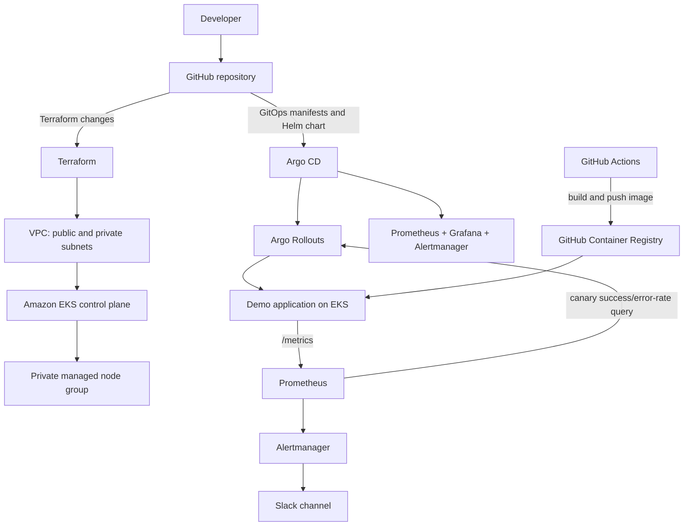

# GitOps Platform on AWS EKS with Terraform, Argo CD, and Argo Rollouts

A portfolio-ready reference implementation of a GitOps delivery platform on Amazon EKS. Terraform provisions a repeatable AWS foundation for development and production; Argo CD reconciles Kubernetes resources from Git; Argo Rollouts performs progressive canary delivery; Prometheus and Grafana provide observability; Alertmanager sends alerts to Slack.

> **Status:** repository scaffold and configuration are generated for you. They have not been applied to an AWS account or validated against a live cluster. Review versions, account quotas, IAM access, image names, CIDRs, and cost before deployment. The rollback-time target is a design objective until measured in your environment.

## What this project demonstrates

- Reusable Terraform modules for a VPC and EKS managed node group, used by both `dev` and `prod` configurations.
- Private worker nodes across multiple Availability Zones; NAT strategy is cheaper for dev and more resilient for prod.
- S3 remote state with versioning/encryption and DynamoDB state locking.
- Declarative Argo CD applications and Helm-based add-on installs.
- An application packaged as a Helm chart with an Argo Rollouts `Rollout` resource.
- Canary analysis scoped to the candidate image version using Prometheus metrics; a failed analysis causes Argo Rollouts to abort the rollout and restore the stable ReplicaSet.
- Prometheus, Grafana, alert rules, Alertmanager, and Slack notification configuration.
- GitHub Actions to build and publish the demo application image to GitHub Container Registry (GHCR).

## Architecture



### Deployment flow

1. Bootstrap an encrypted/versioned S3 state bucket and DynamoDB lock table.
2. Run the same Terraform root with `env/dev.tfvars` or `env/prod.tfvars` and a separate backend key.
3. Configure `kubectl` for the created EKS cluster.
4. Install Argo CD once, configure the repo URL, and create monitoring secrets without committing them.
5. Apply the root Argo CD application. Argo CD then reconciles monitoring, Rollouts, and the demo app from Git.
6. Push a new app image; update the Helm chart image tag in Git. Argo CD syncs the change and Argo Rollouts evaluates Prometheus metrics during the canary.

## Repository layout

```text
.
├── app/                               # Flask demo app with Prometheus metrics
├── charts/demo-app/                   # Helm chart containing Rollout, Service, AnalysisTemplate
├── docs/architecture.md               # Design notes and operational flow
├── env/
│   ├── dev.tfvars                     # Dev settings
│   ├── prod.tfvars                    # Prod settings
│   ├── dev.backend.hcl.example        # Remote-state settings (copy and edit)
│   └── prod.backend.hcl.example
├── gitops/
│   ├── apps/                          # Argo CD child Applications
│   └── bootstrap/                     # Argo CD bootstrap manifests and values
├── scripts/                           # Bootstrap and smoke-test helpers
└── terraform/
    ├── bootstrap-state/               # S3 state bucket + DynamoDB lock table
    ├── environments/platform/         # Shared Terraform root
    └── modules/
        ├── network/                   # Reusable VPC module wrapper
        ├── eks-cluster/               # Reusable EKS module wrapper
        └── platform/                  # Composes network + EKS modules
```

## Prerequisites

Install and configure these tools on your workstation:

- AWS CLI v2 and credentials with permissions to create VPC, IAM, EKS, EC2, CloudWatch, S3, DynamoDB, and related resources.
- Terraform `>= 1.10` (the backend examples use the S3 backend and DynamoDB locking).
- `kubectl`, Helm 3, Docker, Git, and `curl`.
- A GitHub repository for this code and a GitHub Container Registry package.
- A Slack incoming webhook URL for the included Slack alert receiver (the bootstrap script prompts for it).

The AWS account and IAM principal used for cluster creation are granted cluster-admin access by the EKS module's cluster-creator access entry. Use a dedicated least-privilege IAM principal for real environments; avoid deploying with long-lived root credentials.

## 1. Configure the repository

1. Create an empty GitHub repository named `gitops-platform-eks`. Configure the placeholders below before the first push.
2. Edit `env/dev.tfvars` and `env/prod.tfvars`. Replace the example EKS API allow-list CIDR (`203.0.113.10/32`) with your current trusted public IP CIDR. Do not leave the endpoint open to `0.0.0.0/0` for a production environment.
3. Edit `charts/demo-app/values.yaml` and set `image.repository` to `ghcr.io/<your-lowercase-github-owner>/gitops-platform-demo`.
4. Edit `gitops/apps/demo-app.yaml` and replace `REPLACE_WITH_GITOPS_REPO_URL` with your actual GitHub HTTPS clone URL. The bootstrap script injects this value into the root application and AppProject, but it cannot rewrite the copy of this file stored in Git.
5. Make the GitHub package public for a public demo. For a private package, create a `kubernetes.io/dockerconfigjson` pull secret named `ghcr-pull-secret` in namespace `demo` and set `imagePullSecrets: [{ name: ghcr-pull-secret }]` in `charts/demo-app/values.yaml`. Use a GitHub token with only package-read access and never commit it.
6. For the simplest demo, keep the GitOps repository public. If it must remain private, configure read-only repository credentials in Argo CD before syncing the root application.
7. Push the project to the default branch configured in the root Argo CD application (the example uses `main`).
8. Wait for the initial GitHub Actions image workflow. Copy its `sha-<7-character-SHA>` tag into `charts/demo-app/values.yaml` → `image.tag`, then commit and push that value before bootstrapping Argo CD.

## 2. Create the Terraform remote-state backend

Choose a globally unique S3 bucket name and a DynamoDB table name. Example names below are placeholders; AWS S3 bucket names must be globally unique.

```bash
cd terraform/bootstrap-state
cp terraform.tfvars.example terraform.tfvars
# Edit terraform.tfvars with your unique bucket and table names.
terraform init
terraform fmt -recursive
terraform validate
terraform plan
terraform apply
```

The state bootstrap configuration keeps its own state locally to avoid a circular dependency. Store that local state securely or migrate it into the created S3 bucket after the bucket is available.

Copy the backend example for the environment you are deploying and edit the bucket, table, and region values:

```bash
cp env/dev.backend.hcl.example env/dev.backend.hcl
# edit env/dev.backend.hcl
```

The backend file is ignored by Git because it may contain environment-specific infrastructure names. Keep S3 versioning, encryption, public-access blocking, TLS-only bucket policy, and DynamoDB locking enabled.

## 3. Provision EKS (dev or prod)

The Terraform root is shared. The selected backend key isolates state, while the selected tfvars file chooses the environment sizing and NAT strategy.

```bash
cd terraform/environments/platform
terraform init -backend-config=../../../env/dev.backend.hcl
terraform plan -var-file=../../../env/dev.tfvars
terraform apply -var-file=../../../env/dev.tfvars
```

For production, use a separate working copy or run `terraform init -reconfigure -backend-config=../../../env/prod.backend.hcl` and then plan/apply with `../../../env/prod.tfvars`. Switching backend configurations in the same directory changes the selected state, so always confirm the plan and state key before applying.

After provisioning, update your local kubeconfig. Use the cluster name and region printed by Terraform:

```bash
aws eks update-kubeconfig --region ap-south-1 --name gitops-platform-dev
kubectl get nodes
kubectl get pods -A
```

If access fails, confirm the CIDR allow-list, IAM identity, EKS access entry, and AWS region.

### Cost and cleanup warning

EKS control-plane hours, NAT gateways, public IPv4 addresses, EC2 nodes, load balancers, CloudWatch logs, and metrics incur charges. Production uses one NAT gateway per AZ and three minimum worker nodes. Run dev first, monitor AWS billing, and destroy environments when not needed.

To destroy an environment, select the correct backend key and use the same tfvars file used to create it:

```bash
terraform plan -destroy -var-file=../../../env/dev.tfvars
terraform destroy -var-file=../../../env/dev.tfvars
```

Do not destroy the state bucket/table until both environment states are no longer required. S3 bucket resources use `prevent_destroy` intentionally.

## 4. Bootstrap Argo CD and GitOps

From the repository root, export the actual Git URL and run the bootstrap script after `kubectl` points at the correct EKS cluster:

```bash
export GITOPS_REPO_URL="https://github.com/<your-owner>/gitops-platform-eks.git"
./scripts/bootstrap-argocd.sh
```

The script installs Argo CD with the chart version pinned in the script, prompts for an incoming Slack webhook and a Grafana admin password, creates Kubernetes Secrets in the `monitoring` namespace, and applies the Argo CD project/root application. Secret values are not written to repository files or printed to the terminal. Use a real Slack incoming webhook URL and a strong unique Grafana password.

The root application watches `gitops/apps`. Its child Applications install:

- Argo Rollouts via the official Argo Helm repository.
- `kube-prometheus-stack` for Prometheus, Grafana, Alertmanager, and alert rules.
- The local `charts/demo-app` Helm chart.

First reconciliation can take several minutes. If the demo app syncs before the Rollouts/monitoring CRDs exist, Argo CD may show a temporary sync failure; wait for add-ons to install and retry the demo app sync.

> **Exposure note:** Argo CD, Grafana, and Prometheus are `ClusterIP` services; no public ingress is created. Access their UIs through `kubectl port-forward`. Grafana persistence is disabled for the low-cost demo because this repository does not install an EBS CSI driver; dashboards and time-series data can be lost when pods are recreated. Enable persistence only after configuring a storage class and EBS CSI driver. Do not expose admin dashboards publicly without authentication, TLS, and network restrictions.

## 5. Verify the platform

```bash
kubectl get applications -n argocd
kubectl get pods -n argocd
kubectl get pods -n argo-rollouts
kubectl get pods -n monitoring
kubectl get rollouts -n demo
kubectl argo rollouts get rollout demo-app -n demo
```

The `kubectl-argo-rollouts` plugin is optional but useful. Install it using the instructions in the official Argo Rollouts documentation.

Open the application locally:

```bash
kubectl -n demo port-forward svc/demo-app 8080:80
# In another terminal:
curl -i http://127.0.0.1:8080/
curl -i http://127.0.0.1:8080/healthz
curl -s http://127.0.0.1:8080/metrics | head
```

Open Grafana using `kubectl -n monitoring port-forward svc/kube-prometheus-stack-grafana 3000:80` and visit `http://127.0.0.1:3000`. The admin username is `admin`; the password is the value used in the bootstrap prompt.

## 6. Build and release a new application version

The GitHub Actions workflow builds the image when `app/` changes and pushes SHA and `latest` tags to GHCR. Ensure the repository has Actions enabled and `GITHUB_TOKEN` package-write access allowed.

1. Change the application code under `app/` and push to `main`.
2. Wait for the `Build and publish demo image` workflow to finish.
3. Copy the short SHA tag from the workflow output (`sha-<7-character-SHA>`).
4. Update `charts/demo-app/values.yaml` → `image.tag` to that exact SHA tag and commit/push the change.
5. Argo CD detects the desired-state change. Argo Rollouts creates a new ReplicaSet and runs the canary steps and `AnalysisTemplate` query against Prometheus.

The `demo-error-rate` AnalysisTemplate checks the candidate image's 5xx ratio over a two-minute Prometheus window. Each request metric carries the deployed image tag as a `version` label, and the rollout passes the candidate tag into the analysis so it can evaluate the new revision rather than only aggregate service traffic. The query returns zero when there are no matching samples, so generate requests during the analysis window when testing.

Argo Rollouts without an ingress controller or service-mesh traffic router uses replica scaling to approximate canary weight; it does not guarantee exact percentage-based request routing. Add ALB, NGINX, Istio, or another supported traffic router if exact traffic weights are required.

## 7. Exercise automatic canary abort

The demo app has a `/fail` endpoint that returns HTTP 500 and increments `http_requests_total`. To test the analysis safely in a dev cluster:

1. Start a rollout by updating the image tag as described above.
2. While the rollout is in its canary steps, generate repeated requests to the service (using the port-forward above):

```bash
for i in $(seq 1 100); do curl -s -o /dev/null http://127.0.0.1:8080/fail; done
```

3. Watch `kubectl argo rollouts get rollout demo-app -n demo` and the Rollouts analysis logs. The error-rate analysis should fail when the observed error ratio exceeds the configured threshold and the rollout should abort. This test is timing-sensitive; requests must overlap the analysis window.
4. Confirm the stable ReplicaSet becomes active again and investigate the failed AnalysisRun before retrying.

Do not intentionally inject failures into production. The project is configured with a five-percent 5xx threshold, 30-second measurement interval, and a two-minute Prometheus query window. Actual rollback time depends on traffic, metric availability, controller reconciliation, and cluster health; measure it before reporting an SLO such as “under two minutes.”

## 8. Useful commands

```bash
# Terraform formatting and validation
terraform fmt -recursive terraform
cd terraform/environments/platform
terraform init -backend=false
terraform validate

# GitOps health
kubectl get applications -n argocd
kubectl get analysisruns -n demo
kubectl describe rollout demo-app -n demo
kubectl logs -n argo-rollouts deploy/argo-rollouts -f

# Local HTTP checks
curl -i http://127.0.0.1:8080/healthz
curl -i http://127.0.0.1:8080/fail
```

## Security and operational notes

- Never commit AWS keys, kubeconfigs, Slack URLs, Grafana passwords, Terraform state, or filled backend files.
- Use a restricted EKS API endpoint CIDR list. For stronger isolation, use private-only endpoint access via a VPN/bastion or AWS Systems Manager connectivity.
- Use separate AWS accounts for dev/prod when practical, and separate IAM roles with minimal permissions.
- Pin providers, Terraform modules, and Helm charts; update pins deliberately after reviewing release notes and compatibility.
- Enable GitHub branch protection and required checks. For production, use signed commits, artifact/image scanning, and image digests rather than mutable `latest` tags.
- Add persistent storage, backup/restore testing, resource quotas, network policies, Pod Security Standards, and secret management (for example AWS Secrets Manager with External Secrets) before treating this as production-ready.

## References

- [Amazon EKS Kubernetes versions](https://docs.aws.amazon.com/eks/latest/userguide/kubernetes-versions.html)
- [Terraform AWS EKS module](https://github.com/terraform-aws-modules/terraform-aws-eks)
- [Terraform AWS VPC module](https://github.com/terraform-aws-modules/terraform-aws-vpc)
- [Terraform S3 backend](https://developer.hashicorp.com/terraform/language/backend/s3)
- [Argo CD declarative setup](https://argo-cd.readthedocs.io/en/latest/operator-manual/declarative-setup/)
- [Argo CD Helm support](https://argo-cd.readthedocs.io/en/latest/user-guide/helm/)
- [Argo Rollouts](https://argo-rollouts.readthedocs.io/en/stable/)
- [Argo Rollouts Prometheus analysis](https://argo-rollouts.readthedocs.io/en/stable/features/analysis/)
- [kube-prometheus-stack](https://github.com/prometheus-community/helm-charts/tree/main/charts/kube-prometheus-stack)

## License

MIT. See [LICENSE](LICENSE).
